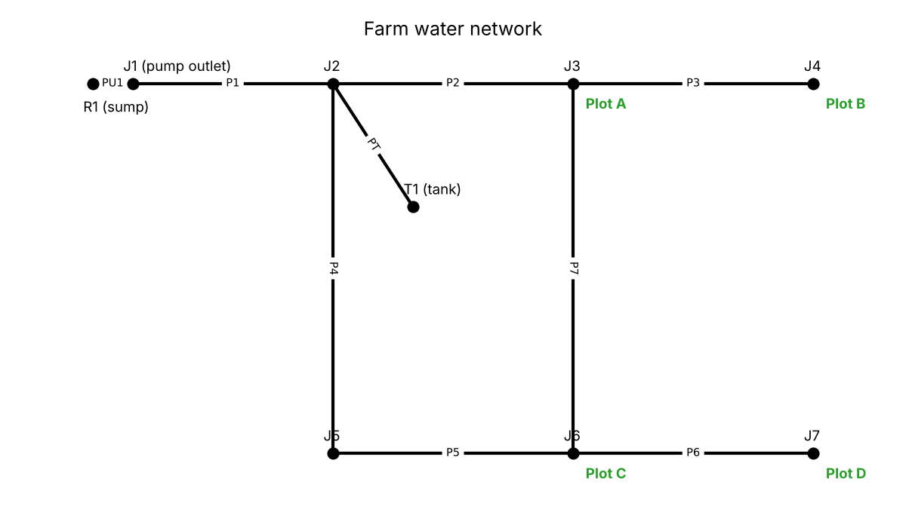
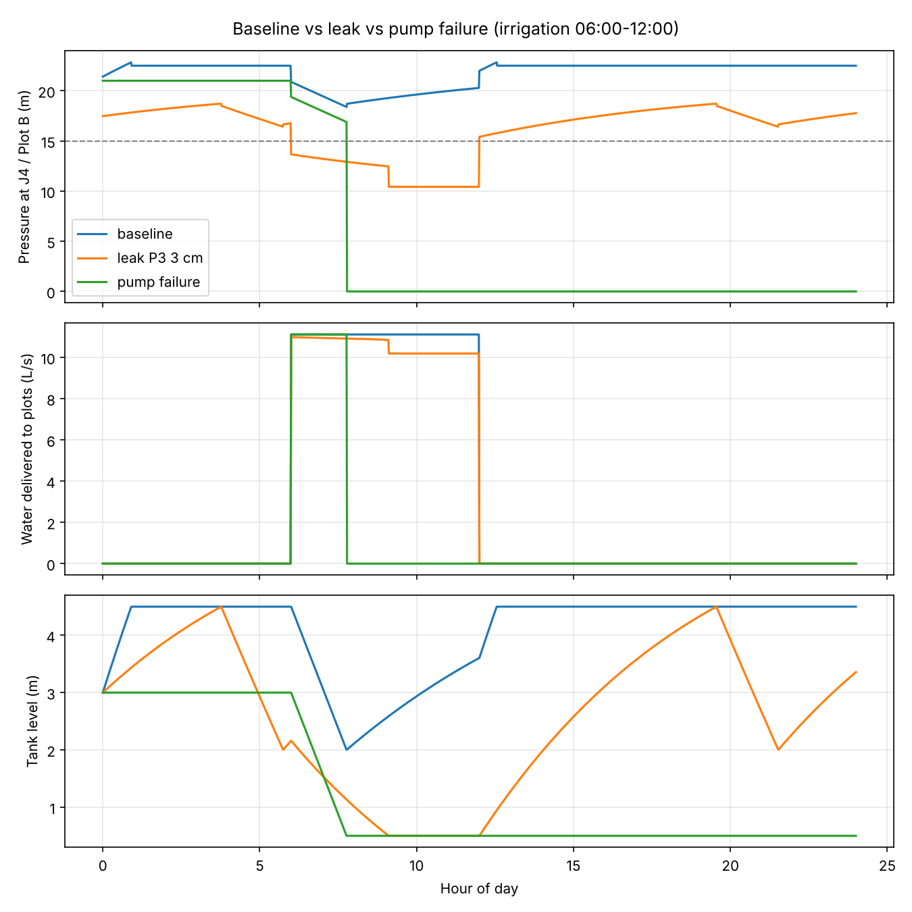

# Phase 2: Water network model

**Output:** baseline pressures and flows for the farm water network, a function that injects a leak at a chosen pipe, and a pump-failure scenario. Everything is checked by an automated test suite.

Reproduce:

```bash
pip install -r requirements.txt
python scripts/phase2_network.py   # writes outputs/phase2/
pytest                             # 18 checks
```

## Network



| Element | Count | Notes |
|---|---|---|
| Reservoir (sump/well) R1 | 1 | Water surface fixed at 8 m |
| Pump PU1 | 1 | 25 m head at 15 L/s; switches on below 2.0 m tank level, off above 4.5 m |
| Tank T1 | 1 | Tower tank, 30 m base, 6 m diameter, 0.5-5.0 m operating range (~127 m³) |
| Junctions J1-J7 | 7 | J1 is the pump outlet; J2 is where the tank connects |
| Pipes P1-P7, PT | 8 | PVC, 80-150 mm. P7 closes a loop between the two branches |
| Farm plots | 4 | Plot A → J3, Plot B → J4, Plot C → J6, Plot D → J7 |

The pump fills the tank, and the tank floats on the system. During irrigation the plots draw from both, and once the tank runs low the pump refills it. Pipe P7 gives a second route to Plots A and C, so a leak on one branch hurts some plots more than others.

### Pressure-driven demand

The network runs in **pressure-driven demand (PDD)** mode. This is step 5 of the simulation loop in the project workflow. A plot whose junction is at or above **15 m** gets its full request. At 0 m it gets nothing, and in between delivery follows WNTR's Wagner curve, `Q = Q_req · ((p - p_min)/(p_req - p_min))^0.5`. Without PDD, a leak could never reduce what reaches a plot.

The simulation uses `WNTRSimulator` and not `EpanetSimulator`, because only `WNTRSimulator` supports leaks together with PDD.

### Irrigation demand

`set_irrigation_demands(wn, {"Plot_A": 60.0, ...})` takes each plot's daily request in m³. It spreads the request evenly over the irrigation window (default 06:00-12:00) and sets it as demand at that plot's junction. Phase 4 will call this once per simulated day with the farm model's requests. Until then, Phase 2 uses a placeholder of 60 m³/day per plot (6 mm over 1 ha).

## Scenarios

| Function | What it does |
|---|---|
| `inject_leak(wn, LeakSpec(pipe, hole_diameter_m, start_time_s, end_time_s, position))` | Splits the pipe at `position` and attaches an orifice leak, `Q = Cd·A·√(2gp)` with `Cd = 0.75`, to the new junction. Leak flow rises and falls with local pressure. |
| `inject_pump_failure(wn, pump, start_time_s, end_time_s)` | Forces the pump closed for the window. The pump's tank-level controls are suspended during the outage and resume afterwards. |

Both return a modified **copy**, so one baseline network serves every scenario.

## Results (one day, 60 m³ requested per plot)



| Scenario | Delivered (m³) | Leaked (m³) | Pumped (m³) | Min plot pressure (m) | Plot A | Plot B | Plot C | Plot D |
|---|---|---|---|---|---|---|---|---|
| Baseline | 240.0 / 240 | 0 | 283 | 17.5 | 100% | 100% | 100% | 100% |
| Leak, 3 cm hole mid-P3 | 228.3 | 824 | 1063 | 10.4 | 98.6% | **88.5%** | 97.9% | 95.5% |
| Pump failure all day | 71.3 | 0 | 0 | 0.0 | 29.7% | 29.7% | 29.7% | 29.7% |

Leak-size sweep on P3 (`outputs/phase2/leak_size_sweep.csv`):

| Hole (cm) | Leaked (m³) | Pumped (m³) | Delivered (m³) | Plot B delivered |
|---|---|---|---|---|
| 0 | 0 | 283 | 240.0 | 100% |
| 1 | 105 | 338 | 240.0 | 100% |
| 2 | 404 | 630 | 240.0 | 100% |
| 3 | 824 | 1063 | 228.3 | 88.5% |
| 4 | 1212 | 1374 | 200.3 | 68.3% |
| 5 | 1432 | 1527 | 166.3 | 47.1% |

What the numbers show:

- **Small leaks are hidden by the pump.** Up to a 2 cm hole, the pump simply runs longer: pumped volume more than doubles, but every plot still gets its full request. Such a leak costs water and energy but does not yet stress the crop. This is the case the stretch-goal leak detector would need to catch from pressure data.
- **Large leaks reach the crop.** From 3 cm, pressure drops below 15 m during irrigation and deliveries fall. The plot immediately downstream of the leak (Plot B on P3) loses the most.
- **Pump failure is bounded by tank storage.** With the pump off, the plots receive about the 71 m³ the tank holds above its minimum level, then nothing. When the tank reaches its minimum level it is treated as empty and cut off (EPANET convention), so pressure falls to zero.

Output files in `outputs/phase2/`:

| File | Contents |
|---|---|
| `baseline_pressure_m.csv` | Hourly pressure at every node (tank row = water level) |
| `baseline_flow_Lps.csv` | Hourly flow in every pipe and the pump (L/s) |
| `scenario_summary.csv` | The scenario table above |
| `leak_size_sweep.csv` | The sweep table above |
| `network_parameters.csv` | Every parameter, its value and its source |
| `farm_network.inp` | The network as an EPANET input file (opens in EPANET 2.2) |
| `network.png`, `scenarios.png` | Figures above |

## Validation (tests/test_network.py)

| Check | Result |
|---|---|
| WNTR vs EPANET engine, demand-driven, full day at 1-minute steps | Pressures agree within 0.001 m and flows within 0.01 L/s |
| Mass balance at every step: supply = deliveries + leak + tank inflow | Residual < 1e-8 m³/s for baseline, leak and pump failure |
| Tank storage: level change × area = integrated net inflow | Error appears only in the step where the tank hits a limit or the pump switches, and stays below one step of flow (< 1 m³) |
| No leak → delivered = requested | 100% at every plot; minimum plot pressure 17.5 m > 15 m |
| Larger leak never delivers more | Holds across 0-4 cm; the 4 cm leak visibly reduces delivery |
| Leak hurts the downstream plot most | A leak on P3 hits Plot B hardest |
| Pump failure | Delivery ≤ usable tank storage; a timed outage recovers afterwards |

## Implementation notes

Three WNTR behaviours turned up while building this. Each is handled in code and covered by a test:

1. **A simulation advances the model's clock.** Running `WNTRSimulator` on a model leaves it at the end of the day, so the next run of that model, or of a copy, returns almost nothing. `run_hydraulics` always simulates a reset copy.
2. **Tank limits and control switches are only checked at whole time steps.** With hourly steps, the tank overshot its minimum level and supplied about 9 m³ more than it held. The hydraulic step is now 1 minute (demand patterns stay hourly). That keeps the error under 1 m³ per event, at about 0.7 s per simulated day.
3. **Competing pump controls break the tank level.** When the "switch on below 2 m" control and an outage rule both act on the pump, the tank keeps supplying water while its level stays frozen. `inject_pump_failure` suspends the pump's own controls during the outage instead of letting them compete.

## Next: Phase 3

Build the farm model: fetch real daily weather, compute ET0 (FAO-56 Penman-Monteith), and run a daily soil-moisture balance for each plot. Its output, the daily request per plot, feeds `set_irrigation_demands` in Phase 4.
