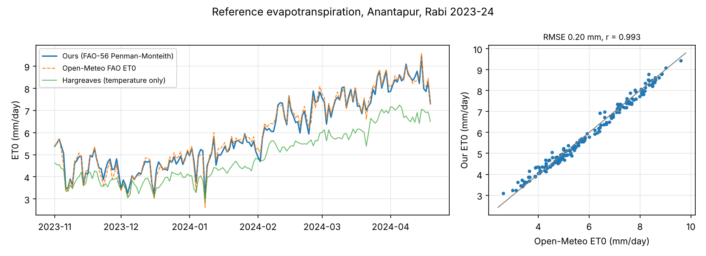
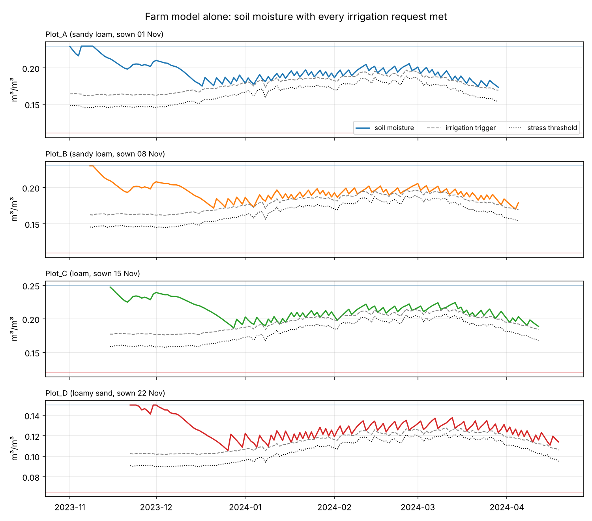
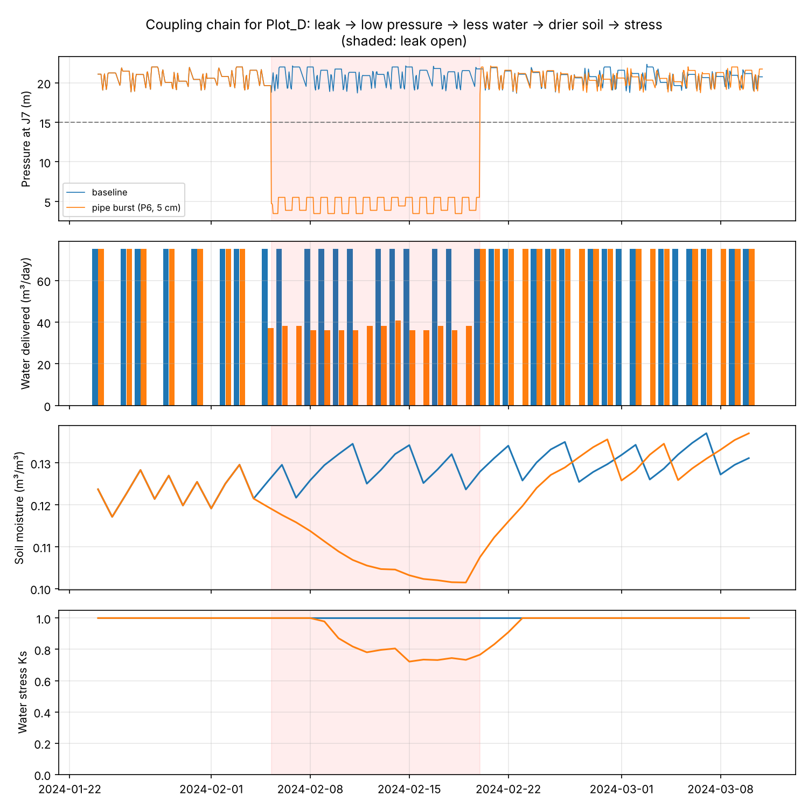
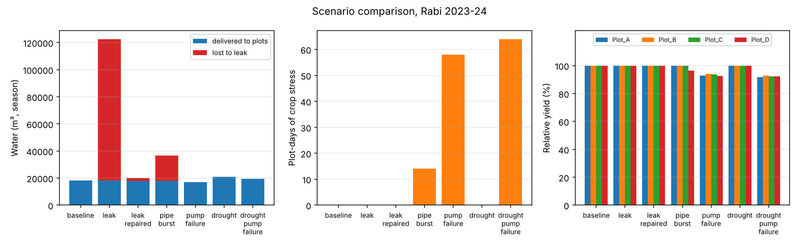
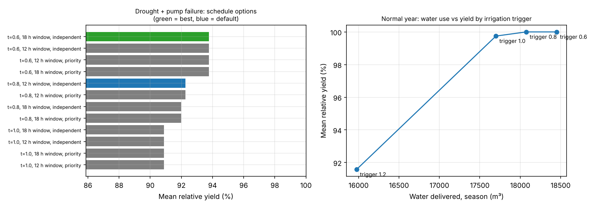

# Smart Irrigation Digital Twin: Final report

*Generated 05 Nov 2026 by `scripts/build_report.py` from the files in `outputs/`.*

## 1. Summary

This project couples a water-distribution model (WNTR/EPANET, pressure-driven demand) with a FAO-56 soil-water model of four maize plots in Anantapur, India, for the 2023-24 Rabi season (171 days, real weather). Every day, each plot's irrigation request becomes demand at a network junction, and the water the network actually delivers at the available pressure becomes that plot's irrigation. The twin can therefore follow a pipe leak or pump failure through to soil moisture, crop stress and yield.

Key results:

- **Coupling chain (pipe burst on P6, 5-19 Feb).** Plot D received 4,758 m³ over the season against 4,950 m³ in the baseline. Its mean soil moisture during the burst was 0.112 against 0.129 m³/m³, with 14 stress days against 0, and relative yield 96.4 % against 100.0 %.
- **An undetected leak costs mostly water and energy.** The 4 cm leak on P3 lost 104,559 m³ and raised pump energy from 1,740 to 10,604 kWh, but added only 0 stress plot-days. The pump compensates by running longer, so the farm sees this leak on the electricity bill before it sees it in the field.
- **Detection pays.** With the leak found within hours (the detector's median delay) and repaired the next day, losses fall to 2,110 m³ and energy to 1,915 kWh.
- **A 10-day pump failure at peak demand** caused 58 stress plot-days and a mean yield of 93.3 % (worst plot 92.6 %).
- **Leak detection (stretch):** on pipes and leak sizes never seen in training, the random-forest detector caught 97.9 % of leak days with a median delay of 1 h, raising false alarms on 5.7 % of leak-free days. A simple threshold rule did worse on both (89.6 % caught, 27.4 % false-alarm days).
- **Schedule optimiser (stretch):** under drought plus pump failure, the best schedule (trigger 0.6 RAW, cap 12 mm, 18 h window, independent) reached 93.8 % mean yield with 59 stress plot-days. The default schedule reached 92.3 % with 64.

## 2. System

| Component | Model |
|---|---|
| Network | 1 sump, 1 pump (15 L/s at 25 m), 1 elevated tank (~127 m³), 7 junctions, 8 PVC pipes with one loop. Pressure-driven demand: full delivery at ≥ 15 m, none at 0 m. Details in [phase2_water_network.md](phase2_water_network.md) |
| Farm | Four 0.5 ha maize plots on junctions J3, J4, J6, J7, with staggered sowing (1-22 Nov 2023) and sandy loam, loam and loamy sand soils. Details in [phase1_scope.md](phase1_scope.md) |
| Weather | Open-Meteo historical archive for 14.68° N, 77.60° E, downloaded once to `data/weather/` |
| Dashboard | `streamlit run app/dashboard.py` |

**Which pipes each plot depends on** (NetworkX graph of the network, `src/irrigation_twin/network/topology.py`). A *critical* pipe is one whose failure alone cuts the plot off from both the pump and the tank:

| Plot | Junction | Pipe routes from hub J2 | Critical pipes | Shortest route (m) |
|---|---|---|---|---|
| Plot_A | J3 | 2 | none | 300.0 |
| Plot_B | J4 | 2 | P3 | 600.0 |
| Plot_C | J6 | 2 | none | 600.0 |
| Plot_D | J7 | 2 | P6 | 900.0 |

This explains the scenario results. A break on P6 starves Plot D, which has no other feed. The loop through P7 gives Plots A and C a second route.

## 3. Farm model (phase 3)

Reference evapotranspiration is computed with FAO-56 Penman-Monteith (eq. 6) from daily Tmax, Tmin, RHmax, RHmin, 2 m wind and solar radiation. The code reproduces the FAO-56 worked examples (Example 18: ET0 = 3.88 against the published 3.9 mm/day). Crop water use is Kc × ET0 with the FAO-56 maize curve, with Kc_mid adjusted for the local climate. Root-zone depletion follows FAO-56 chapter 8, with water stress (Ks) beyond the readily available water.

**Weather and ET0 check.** Season rainfall was 84.0 mm against 1,015 mm of reference ET, so irrigation carries the crop. Our ET0 averaged 5.93 mm/day against 5.96 from Open-Meteo's independent FAO ET0. The bias is -0.03 mm/day, RMSE 0.20 mm/day and r = 0.993. The temperature-only Hargreaves method averaged 4.91 mm/day.

**Farm model alone** (every request met, no network):

| Plot | Irrigation days | Gross irrigation (m³) | Rain (mm) | ETc (mm) | ETa (mm) | Stress days |
|---|---|---|---|---|---|---|
| Plot_A | 55 | 4125.0 | 84.0 | 754.4 | 754.4 | 0 |
| Plot_B | 59 | 4425.0 | 38.6 | 786.3 | 786.3 | 0 |
| Plot_C | 61 | 4575.0 | 25.3 | 818.5 | 818.5 | 0 |
| Plot_D | 66 | 4950.0 | 24.5 | 848.4 | 848.4 | 0 |

## 4. Coupling (phase 4)

The twin advances one day at a time:

1. Read the weather.
2. Compute ETc for each plot.
3. Update soil moisture with rain and crop water use.
4. Turn each plot's irrigation request into junction demand over the 12 h window.
5. Run the day's hydraulics with the active scenario.
6. Apply the delivered water.
7. Log everything.

The tank level and pump status carry over from one day to the next. Each day's hydraulics runs at 1-minute steps.

The chain the project set out to show, leak → low pressure → less water → drier soil → stress, is plotted below for the pipe-burst scenario:

## 5. Scenarios (phase 5)

| Scenario | Description |
|---|---|
| baseline | Normal operation all season. |
| leak | 4 cm hole in pipe P3 from 25 Jan, 06:00, never found or repaired. |
| leak repaired | Same leak, caught by the detector within hours and repaired the next day. |
| pipe burst | 5 cm break in pipe P6 (the only supply to Plot D) on 5 Feb, 06:00. Not found until the crop wilts; repaired on 19 Feb. |
| pump failure | Pump out of service 1-10 Feb while waiting for a spare part. |
| drought | Failed rains (rain x 0), 10 % higher evaporative demand, and the well water level 6 m lower. |
| drought pump failure | Drought plus the 1-10 Feb pump outage: the limited-supply case for the schedule optimiser. |

| Scenario | Delivered to plots (m³) | Lost to leaks (m³) | Pumped (m³) | Pump energy (kWh) | Mean soil moisture (m³/m³) | Lowest soil moisture (m³/m³) | Stress (plot-days) | Low-pressure days | Mean yield | Worst plot |
|---|---|---|---|---|---|---|---|---|---|---|
| baseline | 18,075 | 0 | 18,085 | 1,740 | 0.182 | 0.106 | 0 | 0 | 100.0 % | 100.0 % |
| leak | 18,062 | 104,559 | 122,583 | 10,604 | 0.181 | 0.106 | 0 | 77 | 100.0 % | 100.0 % |
| leak repaired | 18,034 | 2,110 | 20,169 | 1,915 | 0.182 | 0.106 | 0 | 2 | 100.0 % | 100.0 % |
| pipe burst | 17,845 | 18,699 | 36,578 | 3,199 | 0.181 | 0.101 | 14 | 15 | 99.1 % | 96.4 % |
| pump failure | 17,098 | 0 | 17,130 | 1,647 | 0.178 | 0.076 | 58 | 10 | 93.3 % | 92.6 % |
| drought | 20,850 | 0 | 20,882 | 2,382 | 0.178 | 0.103 | 0 | 0 | 100.0 % | 100.0 % |
| drought pump failure | 19,463 | 0 | 19,496 | 2,224 | 0.173 | 0.076 | 64 | 10 | 92.3 % | 91.8 % |

Relative yield by plot (FAO-33, Ky = 1.25):

| Scenario | Yield by plot |
|---|---|
| baseline | A 100 %, B 100 %, C 100 %, D 100 % |
| leak | A 100 %, B 100 %, C 100 %, D 100 % |
| leak repaired | A 100 %, B 100 %, C 100 %, D 100 % |
| pipe burst | A 100 %, B 100 %, C 100 %, D 96 % |
| pump failure | A 93 %, B 94 %, C 94 %, D 93 % |
| drought | A 100 %, B 100 %, C 100 %, D 100 % |
| drought pump failure | A 92 %, B 93 %, C 92 %, D 92 % |

Notes on reading the table:
- "Delivered" is the water that reached the plots. A plot that gets too little keeps asking on later days, so seasonal requests go up in fault scenarios. Delivery and stress are the meaningful measures; the share of requests met is not.
- In the **drought** scenario, rain is removed, ET0 rises 10 % and the well level drops 6 m. Delivered water rises from 18,075 to 20,850 m³, with 0 stress plot-days. Combined with the pump failure, stress rises to 64 plot-days.

## 6. Stretch goals

### 6.1 Leak detection

Full write-up: [stretch_leak_detection.md](stretch_leak_detection.md).

| Held-out test set | Random forest | Threshold rule |
|---|---|---|
| Hourly precision | 0.987 | 0.914 |
| Hourly recall | 0.861 | 0.715 |
| Leak days detected | 97.9 % | 89.6 % |
| Median detection delay | 1 h | 1 h |
| False-alarm days | 5.7 % | 27.4 % |

### 6.2 Irrigation schedule under limited supply

All combinations of irrigation trigger (0.6, 0.8 or 1.0 × RAW), window (12 or 18 h) and tank-water rationing during outages were simulated over the whole season under **drought + pump failure**:

| Trigger (× RAW) | Window (h) | Rationing | Delivered (m³) | Stress (plot-days) | Mean yield | Worst plot |
|---|---|---|---|---|---|---|
| 0.6 | 18 | none | 20,063 | 59 | 93.8 % | 93.1 % |
| 0.6 | 12 | none | 20,063 | 59 | 93.8 % | 93.1 % |
| 0.6 | 12 | priority | 20,063 | 58 | 93.8 % | 93.4 % |
| 0.6 | 18 | priority | 20,063 | 58 | 93.8 % | 93.4 % |
| 0.8 | 12 | none | 19,463 | 64 | 92.2 % | 91.8 % |
| 0.8 | 12 | priority | 19,463 | 63 | 92.2 % | 91.8 % |
| 0.8 | 18 | none | 19,410 | 65 | 92.0 % | 91.6 % |
| 0.8 | 18 | priority | 19,410 | 65 | 92.0 % | 91.7 % |
| 1.0 | 18 | none | 18,788 | 100 | 90.9 % | 90.3 % |
| 1.0 | 12 | none | 18,788 | 100 | 90.9 % | 90.3 % |
| 1.0 | 18 | priority | 18,788 | 100 | 90.9 % | 90.0 % |
| 1.0 | 12 | priority | 18,788 | 100 | 90.9 % | 90.0 % |

### 6.3 Water saved in a normal year

| Trigger (× RAW) | Delivered (m³) | Water saved vs 0.8 (m³) | Saved (%) | Stress (plot-days) | Mean yield |
|---|---|---|---|---|---|
| 0.6 | 18,450 | -375 | -2.1 | 0 | 100.0 % |
| 0.8 | 18,075 | 0 | 0.0 | 0 | 100.0 % |
| 1.0 | 17,700 | 375 | 2.1 | 29 | 99.8 % |
| 1.2 | 15,975 | 2,100 | 11.6 | 320 | 91.6 % |

The lowest-water trigger that keeps mean yield within 0.5 points of the default is **1.0 × RAW**, which saves 375 m³ (2.1 %) with 29 stress plot-days.

## 7. Validation

| Check (validation plan) | Result |
|---|---|
| 1. Standard example networks | EPANET's own example networks, run with the twin's solver and with the EPANET engine: Net1 (9 junctions, 24 h) max pressure difference 0.0001 m, max flow difference 0.000 L/s; Net3 (92 junctions, 168 h) max pressure difference 0.0004 m, max flow difference 0.030 L/s (`outputs/phase2/standard_network_check.csv`) |
| 1. Our network against EPANET | WNTR pressures agree with the EPANET engine within 0.001 m over a full day (`tests/test_network.py`) |
| 1. Mass balance | Largest daily residual across all 7 season runs: 4.3e-18 m³/s |
| 2. ET0 against references | FAO-56 Examples 2, 3, 8, 10 and 18 reproduced. Season RMSE against Open-Meteo ET0 is 0.20 mm/day |
| 2. Soil balance closure | Closes to 1e-9 mm every day (`tests/test_farm.py`) |
| 3. No leak → delivered = requested | Holds in the baseline: 18,075 m³ delivered of 18,075 requested |
| 3. Larger leak never delivers more | Holds (`tests/test_twin.py`, `tests/test_network.py`) |
| 3. Dry spell lowers soil moisture | Holds (`tests/test_farm.py`) |
| 4. Leak detection on held-out leaks | See §6.1. Same-distribution score reported alongside to show the gap |

Run `pytest` to repeat checks 1-3.

## 8. Assumptions and limitations

- The network is a plausible small farm system, not a surveyed one. Pipe roughness, elevations and the pump curve are assumptions (Appendix).
- Single crop coefficient: soil evaporation is not separated from transpiration (the dual-Kc method is not used). Rain fully infiltrates, and capillary rise is zero.
- Yield is a relative index from FAO-33, not a crop-growth simulation.
- Leak size, location and timing are scenario choices.
- The leak detector is trained and tested on simulated sensors with added noise and demand error. A real network adds model error, so expect more false alarms until the twin is calibrated.

## Appendix: parameters and sources

| Parameter | Value | Unit | Source |
|---|---|---|---|
| Pipe material / Hazen-Williams C | PVC / 140 | - | Assumption; typical new PVC |
| Pipe diameters | 80-150 | mm | Assumption; sized for < 1.5 m/s at peak demand |
| Pipe lengths | 100-300 | m | Assumption; plot layout on a ~1 km x 0.3 km farm |
| Junction elevations | 10.0-12.5 | m | Assumption; nearly flat farm |
| Sump water level (R1 head) | 8.0 | m | Assumption |
| Pump design point | 15 L/s @ 25.0 m | - | Assumption; single-point curve |
| Pump efficiency (energy metric) | 75 | % | EPANET default |
| Pump on / off tank level | 2.0 / 4.5 | m | Assumption |
| Tank base elevation | 30.0 | m | Assumption; tower tank |
| Tank diameter | 6.0 | m | Assumption |
| Tank min / init / max level | 0.5 / 3.0 / 5.0 | m | Assumption |
| Required pressure (full delivery) | 15.0 | m | Assumption; sprinkler operating pressure |
| Minimum pressure (zero delivery) | 0.0 | m | WNTR default |
| Pressure exponent | 0.5 | - | WNTR default (orifice behaviour) |
| Hydraulic / pattern time step | 60 / 3600 | s | Project choice; 1 min keeps tank-limit error under 1 m^3 per event |
| Leak discharge coefficient | 0.75 | - | WNTR default |
| Crop | maize (grain) | - | Phase 1 scope |
| Kc ini / mid / end | 0.3 / 1.2 / 0.35 | - | FAO-56 Table 12 |
| Kc mid after climate adjustment | A 1.29, B 1.295, C 1.297, D 1.296 | - | FAO-56 eq. 62, mid-season mean u2 and RHmin |
| Stage lengths ini/dev/mid/late | 30/40/50/30 | days | FAO-56 Table 11, maize, India (dry, cool) |
| Root depth | 0.3 to 1.0 | m | FAO-56 Table 22 (max 1.0-1.7 m); linear growth assumed |
| Depletion fraction p (ETc = 5 mm/d) | 0.55 | - | FAO-56 Table 22, adjusted daily for ETc |
| Yield response factor Ky | 1.25 | - | FAO-33 (Doorenbos & Kassam 1979) |
| Soils θFC / θWP | A sandy loam 0.23/0.11; B sandy loam 0.23/0.11; C loam 0.25/0.12; D loamy sand 0.15/0.065 | m³/m³ | FAO-56 Table 19, mid-range |
| Plot area | 0.5 | ha | Assumption |
| Sowing dates | A 01 Nov, B 08 Nov, C 15 Nov, D 22 Nov | - | Assumption; staggered sowing |
| Irrigation trigger | 0.8 × RAW | - | Assumption (optimised in §6) |
| Max net application | 12.0 | mm/day | Assumption; system sized at ~1.4 x peak ETc |
| Application efficiency | 80% | - | Assumption; typical sprinkler |
| Irrigation window | 06:00-18:00 | - | Assumption |
| Albedo | 0.23 | - | FAO-56 (grass reference) |
| Weather | Open-Meteo historical archive | - | source: Open-Meteo historical weather API (https://archive-api.open-meteo.com/v1/archive) site: Anantapur lat=14.68 lon=77.6 elevation_m=348.0 downloaded: 2026-11-04 |
