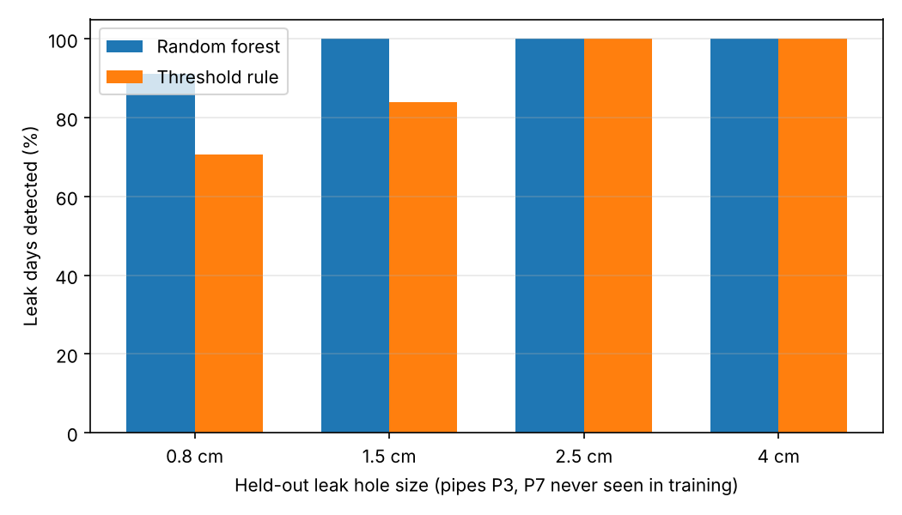

# Stretch goal: Leak detection from pressure anomalies

Reproduce: `python scripts/stretch_leak_detection.py` (about 2 minutes on 4 cores). Results go to `outputs/leak_detection/`.

## Method

The detector compares what the sensors **measure** with what the twin **predicts** for a leak-free network, hour by hour, and classifies the residuals.

| | "Measured" (stands in for the real farm) | "Predicted" (the twin) |
|---|---|---|
| Demand | Planned irrigation **±5 % random error** per plot | Planned irrigation |
| Leak | None, or a leak on a random pipe, size and start hour | Never |
| Sensor noise | Pressure ±0.05 m, pump flow ±1 %, tank level ±0.01 m | None |

**Sensors** (a realistic farm setup): pressure at J2 and the four plot junctions, a pump flow meter, and a tank level gauge.

**Features** (per hour): the residual (measured minus predicted) at each sensor, 3-hour rolling means of the pressure and pump-flow residuals, the tank-level residual trend, the hour of day, and whether irrigation is running.

**Model:** a random forest (300 trees, balanced classes), compared with a simple threshold rule: alarm when the pump-flow residual exceeds 4 σ, or the tank-level residual falls faster than 4 σ, with σ measured on leak-free training hours.

## Held-out evaluation

As the validation plan requires, the test set contains **only leaks the detector never saw in training**:

| | Pipes | Hole sizes |
|---|---|---|
| Training (400 days) | P1, P2, P4, P5, P6 | 1.0, 2.0, 3.0 cm |
| Calibration (200 days) | same as training | same as training |
| **Test (250 days)** | **P3, P7** | **0.8, 1.5, 2.5, 4.0 cm** |

The alarm threshold and persistence were tuned on the calibration set, never the test set. The target was false alarms on at most 5% of leak-free days, then the highest detection rate. The result is a probability ≥ 0.85, with 1 hour of persistence.

## Results on the held-out test set

| Metric | Random forest | Threshold rule |
|---|---|---|
| Hourly precision | **0.987** | 0.914 |
| Hourly recall | **0.861** | 0.715 |
| Leak days detected | **97.9 %** | 89.6 % |
| Median detection delay | 1 h | 1 h |
| False alarms (share of leak-free days) | **5.7 %** | 27.4 % |

By leak size (held-out sizes):

| Hole | Random forest | Threshold rule |
|---|---|---|
| 0.8 cm | 91 % detected, median delay 4 h | 71 %, 5.5 h |
| 1.5 cm | 100 %, 1 h | 84 %, 2 h |
| 2.5 cm | 100 %, 1 h | 100 %, 1 h |
| 4.0 cm | 100 %, 1 h | 100 %, 1 h |

## Interpretation

- **Held-out pipes cost little.** The same forest scores 100% detection with 3.8% false-alarm days on leaks drawn like its training data, and 97.9% with 5.7% on the held-out pipes and sizes. The small drop shows it learned the leak signature, not the generator. Both numbers are reported because the validation plan warns that same-distribution testing "will score near 100% and prove nothing".
- **The smallest leaks are the hard ones.** A 0.8 cm hole loses about 0.75 L/s (2.7 m³/h), comparable to the flow error from ±5% demand uncertainty while four plots irrigate. It is often caught only once its effect on tank level builds up, which explains the 4-hour median delay.
- **The rule-based detector can't be tuned to an acceptable false-alarm rate.** At every persistence setting tried, more than a quarter of leak-free days raised an alarm. On leak-free days the pump-flow residual is normally near zero (90th percentile 0.13 L/s), but about 1% of hours show spikes of 12-14 L/s, the pump's whole flow. Small demand errors shift the hour the tank-level controls switch the pump on or off. The forest learns that a switching spike that the pressures and tank level don't confirm is not a leak.
- **What the most important features say:** the network-wide pressure residual, pump-flow residual, the far-plot pressures (J6, J7) and the tank trend. A pump flow meter plus one or two far-end pressure sensors carry most of the signal.

## Link to the season results

The scenario **leak_repaired** in Phase 5 uses this result. It assumes the detector flags the 4 cm leak within its first hours (median delay 1 h for that size) and the pipe is repaired the next day. Comparing it with **leak** (never repaired) gives the value of detection in water, energy and crop yield. See the final report.

## Limitations

- The "measured" data come from the same hydraulic model, with added noise and demand error. A real network adds model error (pipe roughness, elevations), which would raise false alarms. Calibrating the twin to field data comes first.
- Each test day starts from a clean state: the leak begins during the day being judged. A leak that has run for weeks would be part of the "normal" the operator sees only if the twin were re-calibrated to include it, which it should not be.
- Sensor noise is assumed Gaussian and independent; real sensors also drift.
